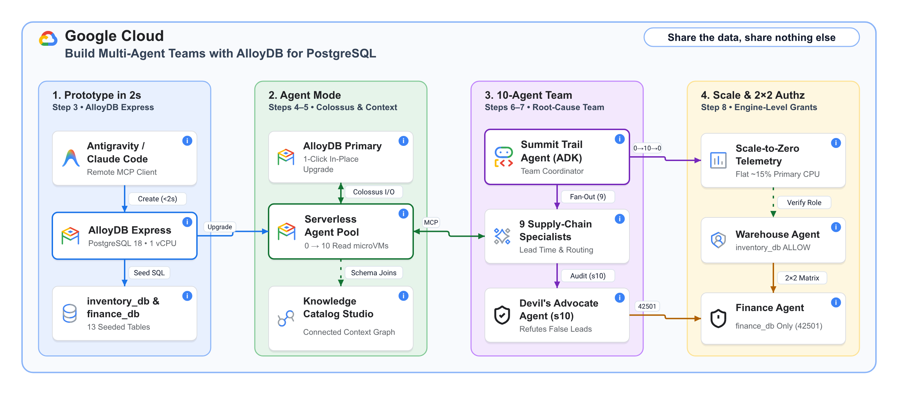

# Build Multi-Agent Teams with AlloyDB for PostgreSQL

**Share the data, share nothing else.**

This repository contains the complete, reproducible infrastructure, SQL schemas, CSV datasets, **Google ADK** multi-agent code, 2×2 PostgreSQL authorization verifier, **go/demos Click-to-Deploy Terraform**, and **Seller Demo Guide** for the **Summit Trail Supply** end-to-end AlloyDB for PostgreSQL for Agents demo and codelab.



---

## What This Demo Proves

| Stage | Capability | Verified Outcome |
| :--- | :--- | :--- |
| **1. Prototype in 2 Seconds** | **AlloyDB Express** (PostgreSQL 18) + **Remote MCP Server** (`alloydb.googleapis.com/mcp`) | Provisions cluster & 1-vCPU primary in **~1.6–2s**, scales compute to **$0** when idle, seeds `inventory_db` (11 tables) & `finance_db` (2 tables). |
| **2. Zero-Migration Graduation** | In-place upgrade (`--no-enable-express`) + **AlloyDB Agent Mode** (`0 → 10` serverless microVMs) + **Knowledge Catalog Studio** | Preserves all schemas/endpoints with zero migration; isolates concurrent agent SQL over shared **Google Colossus** storage while primary CPU holds flat (**~15%**). |
| **3. 10-Agent Root-Cause Team** | **Google ADK** (`ParallelAgent`) over Streamable HTTP MCP (`execute_sql_read_only`) | 9 specialists (`s01`–`s09`) isolate July fill-rate drop (**96.2% → 83.9%**, **12,340 cut units**) to supplier lead-time slippage (`SUP-002`: 21d vs 7d; `SUP-001`: 34d vs 14d) and rigid DC routing; **Devil's Advocate (`s10`)** refutes warehouse shrink via **325 cycle counts (98.62% accuracy)** and demand spikes (**<1.8% variance**). |
| **4. Grants Are the Boundary** | **2×2 PostgreSQL Engine Authorization Matrix** (`warehouse-agent` vs. `finance-agent`) | Cryptographically binds OAuth 2.0 Bearer tokens to IAM DB roles (`priya_warehouse_agent` vs. `diego_finance_agent`), enforcing engine-level **`SQLSTATE 42501`** refusal across databases. |

---

## Repository Structure

```text
alloydb-express-to-agent-teams/
├── README.md                          # Quickstart & architecture reference
├── DEMO_GUIDE.md                      # 4-Pillar Seller Demo Guide (Setup, Access, Walkthrough, Talk Track)
├── _metadata.yaml                     # go/demos catalog metadata
├── .env.example                       # Environment variable template
├── assets/
│   ├── workflow.png                   # 4-Stage Dendrite architecture diagram
│   └── workflow.svg                   # Vector SVG architecture diagram
├── data/
│   ├── sql/
│   │   ├── 01_create_databases.sql    # PG18 CREATEDB/CREATEROLE + inventory_db & finance_db
│   │   ├── 02_seed_inventory_db.sql   # 11 operational supply-chain tables + 2026 YTD dataset
│   │   ├── 03_seed_finance_db.sql     # 2 restricted vendor finance tables (contracts & disputed invoices)
│   │   ├── 04a_setup_authz_inventory_db.sql  # 2x2 CONNECT/SELECT isolation boundary
│   │   ├── 04b_setup_authz_finance_db.sql    # Finance table grants for diego_finance_agent
│   │   └── 05_verify_queries.sql      # Fill-rate, DC variance, 2x2 privilege matrix & invoice SQL
│   └── csv/                           # Deterministic CSV exports of all 13 tables
├── agents/
│   ├── requirements.txt               # Python ADK + MCP dependencies
│   ├── operations_agent.py            # Summit Trail Operations Agent (ADK + Streamable HTTP MCP)
│   ├── run_ops_prompts.py             # Runs Priya's morning fill-rate & DC breakdown checks
│   ├── team_agent.py                  # 10-Agent Parallel Investigation Team (s01-s09 + s10 Devil's Advocate)
│   └── verify_2x2_authz.py            # Automated 2x2 PostgreSQL SQLSTATE 42501 verifier
├── scripts/
│   ├── setup_express_and_seed.sh      # One-command CE/FDE bootstrap (Express + seed + 2x2 IAM authz)
│   ├── upgrade_to_agent_mode.sh       # In-place upgrade + VPC/PSC policy + 0->10 Agent Pool
│   ├── test_mcp_connection.sh         # Quick curl verification of MCP tools/list & fill-rate query
│   ├── generate_csv_data.py           # Deterministically regenerates all 13 CSVs in data/csv/
│   └── cleanup.sh                     # Full teardown (cluster, Agent Pool, VPC/PSC, IAM SAs)
├── codelab/
│   └── index.lab.md                   # Complete CLaaT hands-on codelab source
└── click-to-deploy/                   # go/demos C2D-compliant Terraform (APIs, VPC/PSC, IAM SAs, Secret Manager)
    ├── variables.tf
    ├── main.tf
    └── outputs.tf
```

---

## Quickstart for CEs & FDEs (~2 Minutes to Live Demo)

### 1. Clone & Authenticate

```bash
git clone https://github.com/szinsmeister-google/alloydb-express-to-agent-teams.git
cd alloydb-express-to-agent-teams

export PROJECT_ID="your-gcp-project-id"
export REGION="asia-southeast1"

gcloud config set project "${PROJECT_ID}"
gcloud auth application-default login \
  --scopes="https://www.googleapis.com/auth/alloydb,https://www.googleapis.com/auth/cloud-platform"
```

### 2. Provision AlloyDB Express, Seed Both Databases & Enforce 2×2 Authz

```bash
chmod +x scripts/*.sh
./scripts/setup_express_and_seed.sh
```

> **Note:** `setup_express_and_seed.sh` works immediately in any Google Cloud project with billing enabled (no Agent Mode Preview allowlist required for Fast-Track mode). To upgrade in place to Enterprise AlloyDB + a `0 → 10` serverless **Agent Pool**, run `./scripts/upgrade_to_agent_mode.sh` next.

### 3. Run the Operations Agent, 10-Agent Investigation Team & 2×2 Security Matrix

```bash
cd agents
python3 -m venv .venv
source .venv/bin/activate
pip install --quiet -r requirements.txt

# 1. Priya's morning fill-rate & distribution center check
PROJECT_ID="${PROJECT_ID}" REGION="${REGION}" python3 run_ops_prompts.py

# 2. Launch the 10-agent parallel root-cause team (including s10 Devil's Advocate)
PROJECT_ID="${PROJECT_ID}" REGION="${REGION}" python3 team_agent.py

# 3. Verify 2x2 engine-level database isolation (SQLSTATE 42501)
PROJECT_ID="${PROJECT_ID}" REGION="${REGION}" python3 verify_2x2_authz.py
```

### 4. Clean Up After Your Session

```bash
cd ..
PROJECT_ID="${PROJECT_ID}" REGION="${REGION}" ./scripts/cleanup.sh
```

---

## Antigravity / Claude Code MCP Configuration

To demo live 2-second provisioning straight from your coding agent:

- **Antigravity (`mcp_config.json`):**
  ```json
  {
    "mcpServers": {
      "alloydb": {
        "serverUrl": "https://alloydb.googleapis.com/mcp",
        "transport": "streamable-http"
      }
    }
  }
  ```
- **Claude Code CLI:**
  ```bash
  claude mcp add --transport http alloydb https://alloydb.googleapis.com/mcp \
    --header "Authorization: Bearer $(gcloud auth application-default print-access-token)" \
    --header "X-Goog-User-Project: ${PROJECT_ID}"
  ```

See [DEMO_GUIDE.md](DEMO_GUIDE.md) for the complete 4-pillar seller talk track, objection handling, and live walkthrough cues, or [codelab/index.lab.md](codelab/index.lab.md) for the full 57-minute self-paced workshop.
